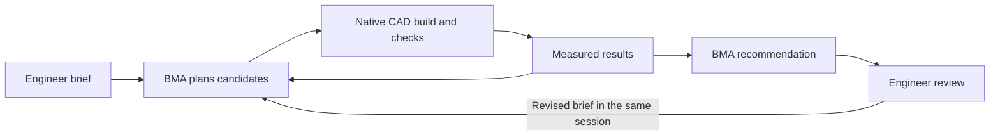

# A resumable CAD design study with BMA

[Sample overview](../README.md) · [Deployment walkthrough](walkthrough.md)

The baseline proves that BMA can invoke a CAD tool and retrieve checked files.
Its dimensions are supplied by the caller, so the model has little to decide.
For that task, a deterministic client would be sufficient.

This example gives BMA a different responsibility: interpret an engineering
brief, choose several candidates, inspect measured geometry, explain tradeoffs,
and revise its recommendation after review. The service retains one BMA
session across these rounds. The native checker continues to decide geometric
acceptance.

## The example: reduce material, then respond to a design review

The bracket has a fixed 160 × 42 mm footprint and mounting interfaces.
The stock thickness and blind-pocket depth are the design variables.

| Round | Engineering brief | What BMA decides |
| --- | --- | --- |
| Initial study | Stock available in 12, 14 and 16 mm; floor at least 2 mm; reduce volume by at least 10% from the 14 mm / 12 mm baseline | Which candidate dimensions to build, how to compare their measured volumes, and which candidate to recommend |
| Review | Increase the minimum floor to 3 mm, retaining the baseline and reduction target | Which earlier result no longer satisfies the brief, whether existing evidence is sufficient, and how to revise the recommendation |

The input files are [brief.json](../examples/design-study/brief.json) and
[review.json](../examples/design-study/review.json). The second file is
**simulated engineer feedback for the demonstration**. It does not constitute
an engineer's approval of a real component.

A native model can pass all 11 original geometric checks and still fail the
revised brief. The native contract requires a 2 mm floor; the second brief
requires 3 mm. Both verdicts are recorded so that an earlier acceptance cannot
silently become approval under new requirements.

`candidate_count` allocates at most that many **new** jobs. The initial round
builds the baseline and at least one alternative. A review can retrieve an
existing candidate with `get_result`, recheck its immutable files against the
new brief, and recommend it without another CAD build. Reports label evidence
as `new` or `reused`. The supplied review sets `candidate_count: 0`, so it
allocates no new jobs and can run with the EC2 worker stopped. If the initial
study has no compliant candidate for the revised brief, BMA must report that
another design round is needed.



This two-variable fixture has an analytic solution. A deterministic search is
an appropriate optimizer for it. The example demonstrates how an agent uses
tools, evidence and changing requirements; it does not claim better design
optimization than a solver. More complex geometry, interface interpretation,
code authoring and analysis integrations are the next sources of agent value.

## Run it

First [install the sample and deploy a dedicated worker](walkthrough.md#run-the-steps-manually).
Use `deploy.py deploy`, which leaves the worker running. `e2e.py` stops its test
worker when it finishes. To reuse a stopped worker, follow the
[restart and deadline instructions](walkthrough.md#operate-and-clean-up).

For a round that allocates new jobs, the worker must be running and have at
least 15 minutes left before its scheduled stop. A review with
`candidate_count: 0` retrieves existing results through the Gateway and S3;
it does not need running CAD compute. Both paths verify that the deployed
worker source matches this checkout. Only one operator should use this
sample worker. Study commands use the same account, Region and stack
arguments as the baseline.

Start the study:

```bash
uv run --frozen python study.py start \
  --brief examples/design-study/brief.json \
  --profile YOUR_PROFILE --region us-east-1 \
  --account YOUR_12_DIGIT_ACCOUNT --stack bma-cad-freecad
```

The command prints `study_submitted` with a `study_id` and `session_id`, then
returns. **BMA keeps working after this client exits.** Save the study ID.
The native jobs continue independently on EC2.

Inspect progress and collect the completed round:

```bash
uv run --frozen python study.py status \
  --study-id YOUR_STUDY_ID --wait-seconds 600 \
  --profile YOUR_PROFILE --region us-east-1 \
  --account YOUR_12_DIGIT_ACCOUNT --stack bma-cad-freecad

uv run --frozen python study.py collect \
  --study-id YOUR_STUDY_ID \
  --profile YOUR_PROFILE --region us-east-1 \
  --account YOUR_12_DIGIT_ACCOUNT --stack bma-cad-freecad
```

`status` reads the remote session and durable items. It correlates the latest
round's input marker with its turn ID, so a previous turn's completed answer
does not count as completion of new work. Waiting has a local time limit; it
does not cancel the BMA turn. Re-run `status` after a disconnect.

`collect` downloads the recorded versions of each inspected candidate's native files,
checks their hashes and executed worker source, and compares the measurements
with the brief. It requires BMA to select the lowest-volume compliant **tested**
candidate, or explicitly report that no candidate meets the requirements.
A final message claiming success is insufficient.

Open the returned `report.md` and its linked native files. To run the review
scenario in **the same BMA session**:

```bash
uv run --frozen python study.py continue \
  --study-id YOUR_STUDY_ID --brief examples/design-study/review.json \
  --profile YOUR_PROFILE --region us-east-1 \
  --account YOUR_12_DIGIT_ACCOUNT --stack bma-cad-freecad
```

Then repeat `status` and `collect`. The continuation keeps the original
measured baseline, earlier discussion and candidate evidence. It supplies the
new brief and previous checked report to the existing session. Each round
receives an allocation of new immutable job IDs and the known candidate
history. Unused IDs do not cause jobs to run. A study supports up to five
rounds, including the initial study.

Every collected result remains **`awaiting_review`**. The sample has no
engineering-release or automatic approval action.

## Observed AWS result

The two-round qualification on 19 October 2026 used `openai.gpt-6.1-sol`,
the deployed FreeCAD worker and one BMA session with `environment=none`.
All three initial candidates passed the 11 native CAD checks.

| Candidate | Stock / pocket | Measured volume | Reduction from baseline | Outcome |
| --- | --- | --- | --- | --- |
| Baseline | 14 / 12 mm | 70,172.718 mm³ | 0% | Measured control |
| Initial recommendation | 12 / 10 mm | 60,684.082 mm³ | 13.52% | Meets the original 2 mm floor requirement |
| Revised recommendation | 12 / 9 mm | 62,560.215 mm³ | 10.85% | Meets the revised 3 mm floor requirement |

The initial client request timed out, but BMA continued the study.
`recover` found the original session through its durable input marker;
it did not submit another study. After collecting that round, the operator
stopped EC2 and submitted the review to the same BMA session. BMA retrieved
the existing 12 / 9 mm candidate with one `get_result` call and revised its
recommendation. The collector downloaded and revalidated those native files.
The review created **zero new CAD jobs** and needed no stop-deadline extension.

[reference.json](../examples/design-study/reference.json) contains the
measurements, tool counts, timestamps and evidence hashes for this live run.
Full service transcripts, version receipts and native files remain in the
operator's ignored `.state` directory. Candidate choices can vary in another
run; a review with no compliant prior candidate returns an unmet goal.

The optional Runtime connection described below is implemented but **was not
live-qualified**. This run did not test command execution, persistent
workspace files, idle restoration or hours of continuous execution.

## What the Codex harness is doing

BMA already runs the managed Codex harness on AWS, including the model/tool
loop, session context and context compaction. An execution environment adds
the filesystem and command execution that a coding workflow needs.

| Capability | This study with remote tools | With a BMA AgentCore Runtime |
| --- | --- | --- |
| Choose candidates and interpret native checks | Yes | Yes |
| Continue after review in the same session | Yes | Yes |
| Keep service-side conversation context | Yes | Yes |
| Run planning and comparison scripts | No execution workspace | Yes |
| Maintain `PLAN.md`, `comparison.json` and `STUDY.md` | Included in the conversation/report instead | The prompt asks the agent to create and update these workspace files |
| Load reusable filesystem skills | No | Available through configured capability directories |
| Keep workspace files after an idle stop | Not applicable | Requires persistent session storage |
| Build general CAD features or run a structural solver | Additional tools/backend work required | Additional tools/backend work required |

The study's [instructions](../prompts/design-study.md) are intentionally
different from the baseline's fixed tool sequence. BMA receives a brief and
candidate IDs; it chooses the dimensions and writes the recommendation.
The client supplies lifecycle controls and validates evidence.

Long-running work does not require one uninterrupted model generation.
Treat the engineering study as a sequence of durable turns, with native jobs
and review between them. Retain the session until the study is finished.

## Add a persistent execution workspace

`study.py start` accepts an existing **BMA exec-server Runtime** through
`--runtime-arn`. A generic HTTP agent Runtime is not sufficient. The official
[BMA Runtime guide](https://docs.aws.amazon.com/bedrock-agentcore/latest/devguide/runtime-get-started-bma.html)
and [Module 2](../../../modules/02-bma-agentcore-runtime/README.md) explain how
to provision the environment and session role.

For a new Runtime, the documented project command is:

```bash
agentcore create --name CadStudy --framework BedrockManagedAgents \
  --session-storage-mount-path /mnt/home
```

Before deployment, configure the Runtime's `envVars` entry in
`agentcore/agentcore.json`:

```json
{"name": "BMA_HOME_DIR", "value": "/mnt/home"}
```

The workspace is `/mnt/home/workspace`. Mounting the exec-server home
preserves its connection state, Codex state and workspace across an idle
stop. Review the generated Dockerfile and pin the Codex release for
reproducibility. Follow the guide's deployment and cleanup steps; this
sample's `deploy.py` provisions the CAD worker, not that Runtime.

The Runtime guide also describes account-wide Transaction Search changes
made by the AgentCore CLI. Review those settings before deploying.

Use a session role that permits:

- The chosen model through `bedrock-mantle:CreateInference`.
- This CAD Gateway through `bedrock-agentcore:InvokeGateway`.
- The selected Runtime's activation and stop operations, as specified in the
  [BMA session-role documentation](https://docs.aws.amazon.com/bedrock/latest/userguide/bedrock-managed-agents-openai-security.html).

The baseline stack's session role grants only model and Gateway access.
The Runtime execution role and BMA session role are separate roles.
`study.py` accepts the combined session-role ARN; it does not edit IAM.

Start a new study with the workspace:

```bash
uv run --frozen python study.py start \
  --brief examples/design-study/brief.json \
  --runtime-arn YOUR_BMA_RUNTIME_ARN \
  --session-role-arn YOUR_BMA_STUDY_SESSION_ROLE_ARN \
  --workspace-directory /mnt/home/workspace \
  --capability-directory /opt/bma/plugins \
  --profile YOUR_PROFILE --region us-east-1 \
  --account YOUR_12_DIGIT_ACCOUNT --stack bma-cad-freecad
```

Environment and role settings are saved once and checked against the remote
session on subsequent commands. The Runtime hosts planning scripts and
working files. CAD construction and trusted verification remain on the
separate x86_64 FreeCAD worker. The Runtime need not contain FreeCAD.

The collected report counts `command_execution` items so that a run can
show whether the harness actually used the workspace. That count alone
does not prove file persistence across an idle stop; qualify stop/resume
separately before relying on it.

## Machine interface and saved evidence

[`sample.json`](../sample.json) lists commands and their side effects.
[design-brief.schema.json](../schemas/design-brief.schema.json) defines inputs;
[study-report.schema.json](../schemas/study-report.schema.json) defines a
collected round.

```text
.state/studies/<study-id>/
  study.json                       Session, AWS scope, rounds and source hashes
  session-created.json             Original BMA session
  session.json / items.json         Latest exported remote state and durable items
  rounds/<round-id>/
    input.json                     Frozen brief, job allocation and previous report
    report.json / report.md         Checked comparison and BMA recommendation
    candidates/<job-id>/            Native files, measurements and version receipts
```

Reports record source hashes for both session creation and collection. Each
collected round is bound to the actual input text stored by BMA, including
the brief and job allocation.

Stdout is JSON Lines. Exit `0` means that the requested command succeeded;
it does not mean that a background study has finished or met its goal.
Use `ready_to_collect` from `study_status`, then require a collected report.
`goal_met` records whether a measured candidate satisfies the current brief.
`status: awaiting_review` always requires a human decision. Exit `1` reports
an execution/evidence error; exit `2` reports invalid CLI arguments.

The client never automatically retries a session create or review submission
after an ambiguous network failure. The error event includes the study ID and
state path. Reconcile it with:

```bash
uv run --frozen python study.py recover \
  --study-id YOUR_STUDY_ID \
  --profile YOUR_PROFILE --region us-east-1 \
  --account YOUR_12_DIGIT_ACCOUNT --stack bma-cad-freecad
```

Recovery reads BMA's session metadata and durable items, requiring a unique
match for the saved input marker and hash, role, model and environment.
It does not submit another message or create another session. If it cannot
establish a unique match, it leaves the study unresolved for inspection.
Then use `status` and `collect`. Keep the local state directory with the
native evidence when archiving a study.

## Operating limits and cleanup

The native tool enforces parameter bounds and geometric acceptance before
publishing a successful result. Candidate IDs and counts are supplied in the
prompt and checked **after execution** by the collector. They are not
tool-side cost quotas. The sample checks the current EC2 stop deadline before
submitting a round that allocates new CAD jobs, but that deadline is not a
BMA inference limit. A review that allocates no jobs still incurs BMA and
artifact-retrieval charges. Use this as an attended development sample.

For unattended customer use, add broker-enforced study leases, candidate
quotas and authorization on every request; a durable controller for wall-clock
limits, cancellation and recovery; and an authenticated engineer-review
interface. A model instruction or a local waiting timeout cannot enforce
those controls.

Cancel the current model turn when required:

```bash
uv run --frozen python study.py cancel \
  --study-id YOUR_STUDY_ID \
  --profile YOUR_PROFILE --region us-east-1 \
  --account YOUR_12_DIGIT_ACCOUNT --stack bma-cad-freecad
```

Cancellation is requested asynchronously. Verify the session becomes idle.
An already dispatched native SSM job may still finish. The sample does not
implement native-job cancellation.

After collecting the needed results, delete the session:

```bash
uv run --frozen python study.py delete-session \
  --study-id YOUR_STUDY_ID \
  --profile YOUR_PROFILE --region us-east-1 \
  --account YOUR_12_DIGIT_ACCOUNT --stack bma-cad-freecad
```

Study commands retain the worker, any Runtime and storage. Follow the
[worker cleanup instructions](walkthrough.md#operate-and-clean-up) and the
Runtime guide's cleanup instructions separately. Session deletion makes
further continuation impossible.

## What to qualify next for a customer template

The support-part tools expose only two dimensions. Expanding BMA's useful
decision space requires a richer CAD contract: editable features, material
choices, mounting interfaces, assemblies, geometric inspection and analysis
results. A planning workspace then lets the harness generate candidate
programs, run comparisons and maintain a reproducible design record.

Keep the verifier and acceptance policy outside that editable workspace.
Test restart recovery, interrupted native jobs, infeasible requirements,
alternate valid designs and verifier failures. Distinguish measured geometry,
solver results and engineer signoff.

For CATIA V6, retain the study/session interface and replace the native
backend with a qualified integration for the licensed application. Its host,
automation API, file handling and verification need their own implementation.
No CATIA backend is supplied here.

## Sources and preview boundaries

Documentation checked on 19 October 2026:

- [BMA on AgentCore Runtime](https://docs.aws.amazon.com/bedrock-agentcore/latest/devguide/runtime-get-started-bma.html):
  managed Codex harness, execution workspace, skills and persistent session storage.
- [BMA REST API](https://docs.aws.amazon.com/bedrock/latest/userguide/bedrock-managed-agents-openai-api-reference.html):
  create/retrieve sessions, submit messages/cancellation, and reconcile durable items.
- [BMA preview limitations](https://docs.aws.amazon.com/bedrock/latest/userguide/bedrock-managed-agents-openai-quotas-limitations.html):
  subagents, programmatic tool calling/code mode and built-in long-term memory
  are outside the documented supported preview workflow.
- [OpenAI agent runtime comparison](https://developers.openai.com/api/docs/guides/agents):
  the managed Agents API, Agents SDK and Responses API have different
  orchestration responsibilities. OpenAI-hosted feature availability does
  not establish BMA feature availability.

BMA's Codex harness is also distinct from the separately named AgentCore
Harness service, whose managed loop uses Strands. This sample continues to
use BMA through `client.beta.agents.sessions`.
