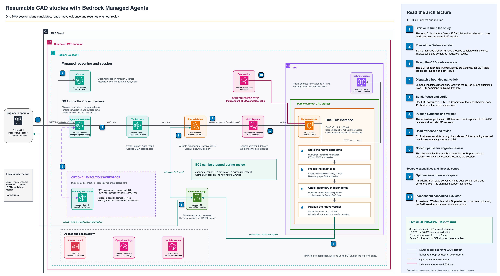
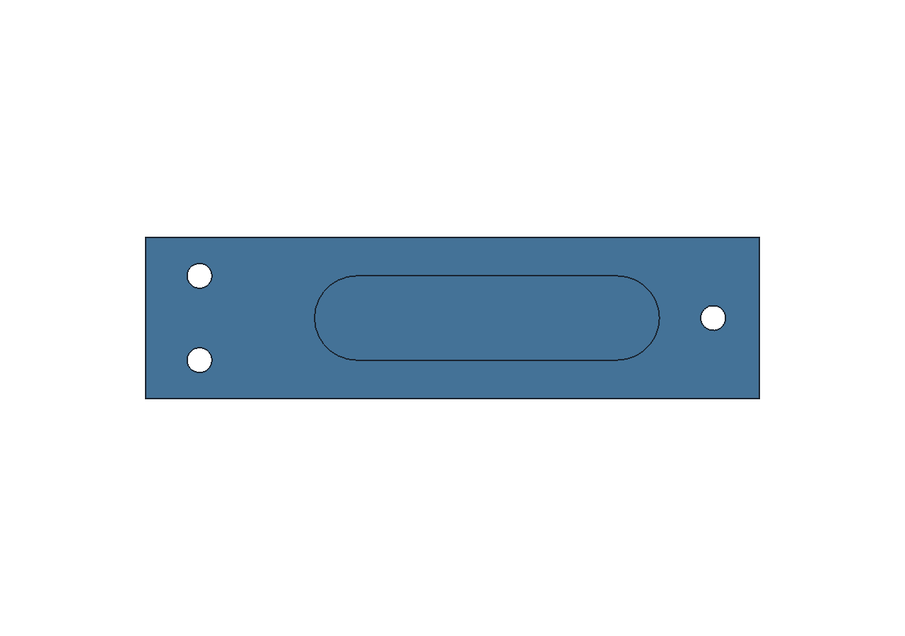

# FreeCAD deployment and verification walkthrough

[Sample overview](../README.md) · [BMA design-study guide](design-study.md)

Use **Amazon Bedrock Managed Agents (BMA), powered by OpenAI**, to call CAD tools
that build an editable FreeCAD part, verify its geometry, and return the native
files with evidence. This sample extends the
[Module 1 Gateway lab](../../../modules/01-bma-environment-none/labs/lab-06-agentcore-gateway/README.md)
with deployable tools and a native CAD worker.

The example creates a **160 × 42 mm support part**, with three 6.5 mm mounting
bores and a capsule blind pocket. You supply stock thickness and pocket depth;
BMA submits those dimensions through MCP tools. A separate checker must pass
all 11 native checks before the result can be accepted.

**FreeCAD is the implemented backend.** The
[backend interface](../docs/adding-a-backend.md) separates native construction,
verification and launching from BMA, the tool contract, and artifact handling.
CATIA V6 is a possible future implementation that requires its own licensed
runtime, automation integration and qualification.

> BMA is in public preview. This sample targets `us-east-1` and pins its own SDK
> dependencies. Check model access in your account before deploying. This is a
> bounded support-part example; it does not implement general text-to-CAD,
> arbitrary Python tools, structural analysis, or manufacturing approval.



[Numbered architecture and blog walkthrough](../docs/architecture.md) ·
[Editable AWS diagram](../docs/architecture.drawio) ·
[Scalable SVG](architecture.svg) ·
[Verification and grader audit](../docs/verification.md)

## Start here

- **Inspect the result:** [the verified example](#the-verified-support-bracket-example)
  includes a preview, native FreeCAD file, STEP file and JSON evidence.
- **Run the complete test:** [the single-command workflow](#run-the-complete-example)
  provisions or uses a worker, runs BMA and the audit, exports logs and stops compute.
- **Integrate automation:** [`sample.json`](../sample.json) describes commands,
  arguments, side effects, report locations and exit codes.
- **Understand or modify it:** see [what runs where](#what-runs-where),
  [native checks](../docs/verification.md), and the [backend interface](../docs/adding-a-backend.md).

## The verified support-bracket example

This repository includes the output of a real BMA/FreeCAD run, qualified on
**19 October 2026 in `us-east-1`**. The part is synthetic example geometry;
it is not a customer design or a manufactured component.



[Editable FreeCAD model](../examples/support-bracket/reference/support.FCStd) ·
[STEP export](../examples/support-bracket/reference/support.step) ·
[Native check report](../examples/support-bracket/reference/checks.json) ·
[Machine-readable qualification record](../examples/support-bracket/reference/verified-example.json)

| Input or acceptance criterion | Example |
| --- | --- |
| Stock envelope | 160 × 42 × 14 mm |
| Mounting bores | Three through bores, diameter 6.5 mm |
| Bore centres, measured from the stock origin | `(14, 10)`, `(14, 32)`, `(148, 21)` mm |
| Capsule pocket | `x=44..134`, `y=10..32` mm, 11 mm end radii |
| Blind pocket depth | 12 mm |
| Residual floor | 2 mm, measured from the native solid |
| BMA integration | Both `create_support` and `get_result` completed |
| Native checks | All 11 passed |
| Grader audit | Valid control passed; all four deliberate defects rejected |
| Observability and cleanup | Worker/broker logs exported; test session deleted; worker confirmed stopped; S3 versions still readable |
| Native runtime | FreeCAD 1.1.4, OCCT 7.8.1 |
| Recorded time | BMA turn: 79.1 s; native job: 16.6 s; full qualification: 283.2 s, excluding deployment |

The [JSON example](../examples/support-bracket.json) is the input source of
truth. [`example.schema.json`](../schemas/example.schema.json) defines its
structure, and the application also checks the relationship between thickness,
pocket depth and the expected floor.

The reference is an exported result from a new deployment of this sample in
an existing public subnet, followed by `e2e.py --existing-stack`.
The source hashes in the qualification
record identify the executed worker and client files. The recorded timings
describe this one run; they are not a latency benchmark or cost estimate.
The one-time scheduled stop was configured; this run verified the separate
immediate cleanup stop rather than waiting for that future deadline.
The BMA response did not report token usage for this run, so the reference
does not claim measured token cost.

Verify the checked-in reference files locally after installing dependencies:

```bash
uv run --frozen python evidence.py verify-reference
```

This validates the JSON, file sizes, hashes and required checks. It does not
rerun FreeCAD or invoke AWS. A fresh native qualification uses the live
workflow below.

## Prerequisites

- Python 3.12+ and [uv](https://docs.astral.sh/uv/getting-started/installation/)
  on macOS or Linux. The native FreeCAD application runs on Linux EC2, so a
  local FreeCAD installation is not required.
- An AWS account with BMA and the chosen OpenAI model enabled in `us-east-1`.
  The default is `openai.gpt-6.1-sol`, default service tier, low reasoning effort.
- An authenticated AWS profile or standard SDK credential chain. Account and
  Region are explicit; these scripts do not edit your AWS configuration.
- Deployment permissions for CloudFormation and the resources it creates:
  IAM, EC2/VPC, S3, Lambda, Systems Manager, CloudWatch Logs, AgentCore Gateway
  and EventBridge Scheduler.
- The caller needs BMA session API permissions and `iam:PassRole` on the
  generated `SessionRoleArn`, plus permission to describe the stack and worker
  and read the artifact bucket, including `s3:GetObjectVersion`. See the
  [BMA caller-policy guidance](../../../modules/01-bma-environment-none/00-prerequisites.md).
  This sample creates its own session role, so you do not need to create the
  workshop's role as well. Running the native audit also requires operator
  `ssm:SendCommand` and `ssm:GetCommandInvocation` permissions. The end-to-end
  runner additionally needs `logs:FilterLogEvents`, `ec2:StopInstances` and
  `bedrock-mantle:DeleteAgentSession` for log capture and cleanup.

The runtime roles are defined in
[`cad_workflow/infrastructure.py`](../cad_workflow/infrastructure.py). Deployment
does not attach permissions to your calling identity.

## Install and validate locally

From the repository root:

```bash
cd samples/cad-workflow
uv sync --frozen
uv run --frozen python install_guard.py
uv run --frozen python deploy.py validate
```

The installer downloads a pinned, checksum-verified CloudFormation Guard
binary into the ignored `.tools/` directory. It supports macOS and Linux on
Arm64 and x86_64.

Validation needs **no AWS credentials or running CAD application**. It runs
the unit tests, renders both network variants, validates them with `cfn-lint`
and Guard, and verifies that four deliberately weakened infrastructure
configurations are rejected. Rendered templates go to `.state/validation/`.
These checks do not execute native FreeCAD or BMA.

## Run the complete example

Replace the uppercase placeholders with your AWS profile and 12-digit account.
You can omit `--profile` to use the standard credential chain.

```bash
# Creates billable resources, invokes BMA, and stops the worker after the test.
uv run --frozen python e2e.py --deploy \
  --example examples/support-bracket.json \
  --profile YOUR_PROFILE --region us-east-1 \
  --account YOUR_12_DIGIT_ACCOUNT --stack bma-cad-freecad --hours 4
```

Use a new stack name. A VPC, subnet and Internet Gateway are created by
default. If you need an existing public subnet, add both
`--vpc-id YOUR_VPC_ID --subnet-id YOUR_SUBNET_ID`.

For an already running stack built from the same worker source:

```bash
uv run --frozen python e2e.py --existing-stack \
  --example examples/support-bracket.json \
  --profile YOUR_PROFILE --region us-east-1 \
  --account YOUR_12_DIGIT_ACCOUNT --stack bma-cad-freecad
```

**Both live modes delete their own BMA session and stop the selected worker
after exporting evidence.** Use a dedicated test worker with no other active
jobs. The runner checks sample ownership, backend, worker source hash and
bootstrap identity before using it. It does not silently upgrade a worker
whose source differs.

The runner executes these stages:

| Stage | What must succeed |
| --- | --- |
| Identity and optional deployment | STS matches the supplied account; local checks and AWS change-set validation pass |
| Worker provenance | The deployed backend and source hashes match the checkout and bootstrap record |
| BMA and native CAD | Both MCP tools complete; FreeCAD produces and checks the requested part |
| Native audit | The control and four semantic rejection cases meet their expectations |
| Evidence verification | The downloaded native files, check reports, parameters and executed source hashes agree |
| CloudWatch export | Job-correlated worker and broker log events are captured |
| Session and compute cleanup | This run's session is deleted and EC2 reaches `stopped` |
| Retained artifacts | Recorded S3 versions remain retrievable with matching hashes after the stop |

The final stdout event has this shape; the job ID and paths vary:

```json
{
  "event": "e2e_finished",
  "status": "passed",
  "job_id": "<32-character-job-id>",
  "report": "<absolute-path>/.state/e2e/<job-id>/report.json",
  "artifact_directory": "<absolute-path>/artifacts/<job-id>"
}
```

Success requires **exit code `0` and report status `passed`**. Exit `1` means
execution or qualification failed; exit `2` means CLI arguments were invalid.
Stage logs and a schema-validated report are written even when an execution
stage fails. Input errors that occur before execution fail before AWS calls.

Validate a completed run again without making AWS calls:

```bash
uv run --frozen python evidence.py verify-run \
  --report .state/e2e/JOB_ID_FROM_THE_RUN/report.json
```

The native and BMA artifacts remain in `artifacts/<job-id>/`. CloudWatch
exports are `cloudwatch-worker.json` and `cloudwatch-broker.json` there.
Deleting a BMA session does not delete these exported files.

## Run the steps manually

For development, the same components can be run separately:

```bash
uv run --frozen python deploy.py deploy \
  --profile YOUR_PROFILE --region us-east-1 \
  --account YOUR_12_DIGIT_ACCOUNT --stack bma-cad-freecad --hours 4

uv run --frozen python run.py \
  --profile YOUR_PROFILE --region us-east-1 \
  --account YOUR_12_DIGIT_ACCOUNT --stack bma-cad-freecad \
  --thickness 14 --depth 12
```

Unlike `e2e.py`, these two commands leave the session and worker available.
Run the [native audit](#audit-the-native-grader), then follow
[operation and cleanup](#operate-and-clean-up).

Deployment checks the authenticated account with STS, runs local validation,
resolves Ubuntu's published AMI parameter, creates a CloudFormation change set,
checks its AWS validation results, then executes it. Allow roughly 10–20 minutes
for provisioning and FreeCAD installation. Bootstrap success is not a native
CAD test; run the example above after the stack is ready.

The default deployment creates a dedicated VPC, subnet and Internet Gateway.
To use an existing public subnet, add both
`--vpc-id YOUR_VPC_ID --subnet-id YOUR_SUBNET_ID` to the deploy command. The
subnet must belong to that VPC and have an active Internet Gateway default
route. The sample creates a new security group with **zero inbound rules**.

Use `--model` when deploying to select a different supported OpenAI model; the
session role is restricted to that model. A successful stack deployment does
not confirm model entitlement. The deployer refuses to update an existing
worker silently. Use a new stack name for a new source revision and preserve
the earlier evidence before removing superseded resources.

The client prints its job ID, BMA session ID, tool calls, final verdict, and
artifact directory. For example, the default dimensions request a **14 mm
stock, 12 mm blind pocket, and 2 mm residual floor**. Stock thickness must be
10–20 mm and pocket depth 1 mm through `thickness − 2 mm`.

```text
artifacts/<job-id>/
  support.FCStd          Editable FreeCAD feature tree
  support.step           Neutral solid export
  preview.png            Native CAD preview
  author.json            Native runtime versions and feature names
  checks.json            Eleven checks, measurements and input hashes
  native-result.json     Verdict and versioned artifact manifest
  request.json           Exact submitted dimensions
  aws-context.json       Account, Region and stack for scoped cleanup
  bma-session.json       BMA session definition and ID
  bma-events.jsonl       Event stream, including tool activity
  bma-items.json         Stored conversation and tool records
  bma-turns.json         Terminal turn event
  bma-receipt.json       Model settings, elapsed time and tool count
  cloudwatch-worker.json Worker log export (end-to-end runner)
  cloudwatch-broker.json Broker log export (end-to-end runner)
  bma-deletion.json      Session cleanup receipt (end-to-end runner)
```

Phase logs and failure diagnostics are included when available. The client
downloads the **specific S3 versions** recorded by the supervisor, checks
their sizes and SHA-256 hashes, and checks that the accepted report covers
the downloaded native files. Model-written success text is not the verdict.

## Audit the native grader

After a successful run, use its job ID while the same worker is still running:

```bash
uv run --frozen python audit.py \
  --profile YOUR_PROFILE --region us-east-1 \
  --account YOUR_12_DIGIT_ACCOUNT --stack bma-cad-freecad \
  --source-job JOB_ID_FROM_THE_SUCCESSFUL_RUN
```

The operator-only audit checks a valid control plus four defects: a through
pocket, a 1 mm floor, a displaced mounting bore, and an incorrect STEP export.
Each defect must fail its intended geometric check. A crash or timeout does
not count as a successful rejection. See [verification](../docs/verification.md)
for coverage and limits.

## What runs where

| Component | Responsibility |
| --- | --- |
| Bedrock Managed Agents | Managed model and tool-calling loop; `environment=none` |
| AgentCore Gateway | IAM-authenticated MCP connector; protocol `2025-03-26` |
| Lambda broker | Validate `create_support` / `get_result`; reserve a job; dispatch a fixed SSM document |
| EC2 supervisor | Serialize jobs, isolate processes, freeze bytes, require verification and publish evidence |
| FreeCAD author and checker | Two sequential native processes under different Linux users |
| S3 | Private, encrypted, versioned files, measurements and verdicts |
| CloudWatch / X-Ray | Worker and broker logs; Lambda active tracing |
| EventBridge Scheduler | One-time, independent EC2 stop at the configured UTC deadline |

BMA, Gateway and Lambda are managed services outside the worker VPC. The
sample does not deploy AgentCore Runtime. The single EC2 VM supplies FreeCAD,
not model inference. Its public IP is for outbound HTTPS; SSM receives work
over a worker-initiated connection.

Only the trusted supervisor has AWS permissions. The CAD processes use
private network namespaces, read-only system paths, separate temporary
directories and resource limits. The broker cannot publish accepted results,
and agent input cannot choose code, shell commands, resource IDs, paths or a
different CAD backend. This is a single-operator sample, not a shared tenant
isolation design.

## Operate and clean up

```bash
uv run --frozen python deploy.py status \
  --profile YOUR_PROFILE --region us-east-1 \
  --account YOUR_12_DIGIT_ACCOUNT --stack bma-cad-freecad

# Delete this job's saved BMA session after exporting the conversation.
uv run --frozen python cleanup.py delete-session \
  --profile YOUR_PROFILE --region us-east-1 \
  --account YOUR_12_DIGIT_ACCOUNT --stack bma-cad-freecad \
  --job-id JOB_ID_FROM_THE_RUN

# Stop compute immediately, preserving the root disk and S3 artifacts.
uv run --frozen python cleanup.py stop \
  --profile YOUR_PROFILE --region us-east-1 \
  --account YOUR_12_DIGIT_ACCOUNT --stack bma-cad-freecad

# After preserving needed files and logs, remove the stack.
uv run --frozen python cleanup.py delete-stack \
  --profile YOUR_PROFILE --region us-east-1 \
  --account YOUR_12_DIGIT_ACCOUNT --stack bma-cad-freecad
```

Session cleanup checks the locally recorded job's account, Region and stack.
Stopping compute and deleting the stack are scoped to resources tagged as
belonging to this sample. Stop/delete requests return before AWS finishes;
verify completion in EC2 or CloudFormation.

**The scheduled stop is cost control, not job scheduling or teardown.** Its
absolute UTC `StopAtUtc` deadline can interrupt a running CAD job. EBS, S3 and
logs remain billable after a stop; model and tool usage are separately charged.
Starting the worker after that deadline does not re-arm the schedule. Before
restarting, use CloudFormation's **Use existing template** option to update
`StopAtUtc` to a future UTC time, preserving other parameters, and wait for
that update to complete. The default EC2 instance is `t3.medium`, with a
30 GiB encrypted gp3 root disk and standard CPU credits.

Stack deletion terminates EC2 and deletes its root disk and CloudWatch log
groups. The S3 bucket and all object versions are **retained intentionally**;
record its name from `.state/<stack>/before-delete.json` and apply your data
retention policy separately. BMA sessions also persist until explicitly
deleted. Supplied existing VPCs and subnets are not deleted.

CloudWatch groups are `/cad/<stack>/worker` and `/cad/<stack>/broker`, retained
for 30 days while the stack exists. Bootstrap diagnostics are
`/var/log/cad-workflow-bootstrap.log` and `/var/log/cloud-init-output.log`.
See the [architecture notes](../docs/architecture.md#logs-and-export) for log
export and the distinction from a complete OpenTelemetry pipeline.

## Machine-readable interface

The README's YAML front matter points to [`sample.json`](../sample.json).
All manifest paths are relative to this sample directory, except
`working_directory`, which is relative to the repository root. The manifest's
commands are argument arrays; an automation client appends the required
account and stack flags without evaluating a shell template.

| Contract | File | Consumer behavior |
| --- | --- | --- |
| Sample discovery | [`sample.json`](../sample.json) | Discover commands, required flags, outputs and side effects |
| Example input | [`examples/support-bracket.json`](../examples/support-bracket.json) | Supply the declared millimetre dimensions |
| Example schema | [`schemas/example.schema.json`](../schemas/example.schema.json) | Validate the JSON structure; the application also enforces the floor relationship |
| Live run report | [`schemas/e2e-report.schema.json`](../schemas/e2e-report.schema.json) | Require `status: passed`, complete stage results and confirmed cleanup |
| Portable reference | [`schemas/reference.schema.json`](../schemas/reference.schema.json) | Verify the committed native files and recorded check results offline |

`e2e.py` writes JSON Lines to stdout. Each stage emits `stage_started` and
`stage_finished`; the terminal event is `e2e_finished`. Child commands'
human-readable output goes to stage log files, whose paths are recorded in
the report. A passing report requires both tools, the native checks, all five
audit cases, both log exports and cleanup. A skipped or failed stage cannot
be represented as a successful end-to-end run.

The private report includes the account, stack, job ID and source hashes.
Keep it with its `artifacts/<job-id>/` directory when archiving a run.
For an explicitly reviewed, portable example, export the reference into a
new directory:

```bash
uv run --frozen python evidence.py export-reference \
  --report .state/e2e/JOB_ID_FROM_THE_RUN/report.json \
  --directory artifacts/exported-reference

uv run --frozen python evidence.py verify-reference \
  --directory artifacts/exported-reference
```

The exporter requires a passed run, verifies the saved evidence, and copies
only the native model, STEP, preview, checks and a qualification manifest.
It excludes AWS resource locations and conversation logs and refuses to
overwrite an existing reference directory.

The GitHub Actions workflow runs offline validation; it needs no AWS secrets
and does not provision infrastructure or run paid inference. Live runs remain
explicit operator commands.

## Troubleshooting

Start with the report's `errors` and the failed stage's `log` path. Preserve a
failed job ID and use a new job for the next attempt; immutable records prevent
a retry from silently replacing earlier evidence.

| Symptom | Where to look and what to check |
| --- | --- |
| Missing profile or wrong account | Refresh the intended AWS login and check `--profile` / `--account`; identity failures occur before CAD dispatch |
| CloudFormation deployment failure | `.state/<stack>/failed-events.json` or `validation-events.json`; resolve the reported permission, quota or resource issue |
| VPC quota exhausted | Use both existing-network flags with an appropriate public subnet |
| Worker source mismatch | Deploy the checkout under a new stack name; the runner does not patch a different worker |
| Worker is stopped | Set a future stop deadline first, restart the instance, and wait for Systems Manager connectivity before testing |
| BMA access or tool failure | Check model entitlement, the caller's session permissions and `iam:PassRole`, and the session role's exact Gateway permission |
| Native rejection | Inspect `checks.json`, native phase logs and failure diagnostics in `artifacts/<job-id>/` |
| Audit rejection case fails | Inspect `audit-<suite-id>/audit.json`; a crash does not satisfy a semantic rejection |
| No CloudWatch events | Check `logs:FilterLogEvents`, the stack's log groups and SSM log delivery; the runner waits up to 90 seconds |
| Hash or source verification failure | Preserve the differing files and report; compare their recorded versions and hashes before accepting the result |

On failures after worker provenance has been verified, the runner attempts
session cleanup and worker stop and records any cleanup failures separately.
If the local process is forcibly killed or loses credentials, verify EC2
state explicitly; the independent scheduled stop remains the fallback.

## Source map and extension points

```text
cad_workflow/
  contract.py                Bounded inputs and required verification report
  backends/__init__.py        Deployment-owned backend selection
  backends/freecad/           Native author, verifier and application launcher
  broker.py                  Gateway Lambda implementation
  worker.py                  Isolation, freezing and artifact publication
  infrastructure.py          CloudFormation renderer and source bundle
  example.py                 JSON input and saved-evidence validation
  study.py                   Candidate comparisons and BMA recommendation checks
bootstrap.sh                 Pinned FreeCAD download and worker setup
deploy.py / run.py            Provision the sample and invoke BMA
e2e.py                       Live qualification, JSON reporting and cleanup
study.py                     Persistent studies, review, recovery and collection
evidence.py                  Offline verification and portable reference export
cleanup.py                   Scoped compute, stack and session cleanup
audit.py / ops/               Operator-only native mutation audit
sample.json / schemas/        Machine interface and JSON Schemas
examples/                    Input fixture and verified native reference files
prompts/                     Instructions for the BMA design-study workflow
tests/ / security.guard       Offline contract, evidence and infrastructure checks
docs/                        AWS diagram, walkthrough and backend guidance
```

FreeCAD is pinned to the official
[1.1.4 Linux x86_64 py311 AppImage](https://github.com/FreeCAD/FreeCAD/releases/tag/1.1.4)
with SHA-256
`f6dc6ba676e5ac96a565ebc8d657232f94c6158e85b4352141bd1a46f6b43434`.
No FreeCAD binary or customer deployment data is stored in this repository.
The resolved Ubuntu AMI and worker source hash are saved at deployment time;
Ubuntu package repositories can still change.

`.state/`, `.tools/`, `.venv/` and `artifacts/` are ignored by Git. Archive
selected evidence deliberately before deleting a local checkout.

For another customer or CAD system, start with the
[backend guide](../docs/adding-a-backend.md). Broader geometry contracts, private
egress, workload admission, cancellation, engineer approval and qualified
native-file input handling require additional implementation.

## References

- [Bedrock Managed Agents with the OpenAI SDK](https://docs.aws.amazon.com/bedrock/latest/userguide/bedrock-managed-agents-openai.html)
- [BMA security and session roles](https://docs.aws.amazon.com/bedrock/latest/userguide/bedrock-managed-agents-openai-security.html)
- [AgentCore Gateway](https://docs.aws.amazon.com/bedrock-agentcore/latest/devguide/gateway.html)
- [AgentCore Runtime with BMA](https://docs.aws.amazon.com/bedrock-agentcore/latest/devguide/runtime-get-started-bma.html) — an alternative execution environment used by Module 2
